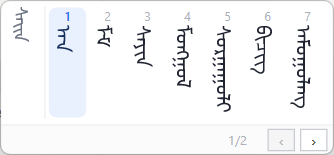
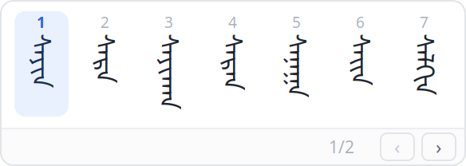
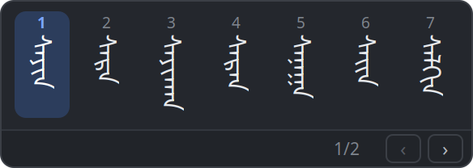
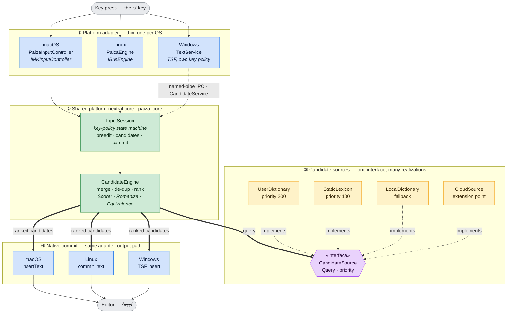
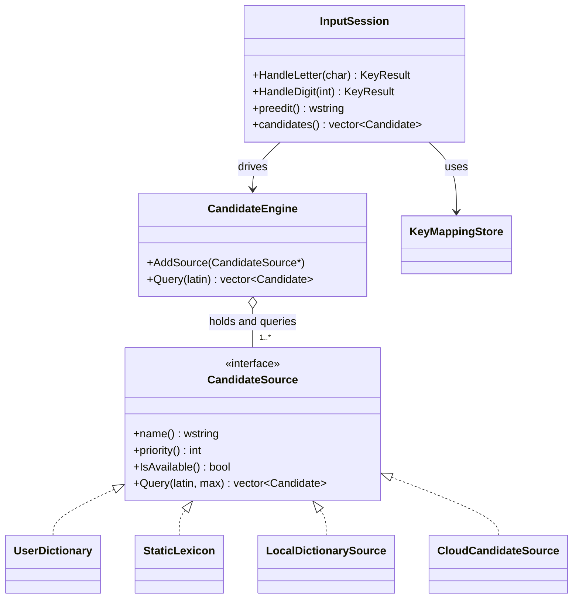

# Paiza Mongolian IME

[](LICENSE)
[](COMMERCIAL-LICENSE.md)

A Traditional Mongolian (ᠮᠣᠩᠭᠣᠯ ᠪᠢᠴᠢᠭ) input method with a shared,
platform-neutral C++20 engine and native front-ends on **Windows** (Text
Services Framework), **macOS** (InputMethodKit) and **Linux** (IBus). All
three are at feature and settings-UI parity (see
**docs/platform-parity.md**); Windows is the reference front-end, built on
a loosely-coupled candidate service process and an extensible
candidate-source architecture.

## Screenshots

Typing `sa` — vertical Mongolian candidates with their selection number
above each word, the highlighted candidate, and the page indicator with
page buttons in the bottom-right corner.

**Windows** (Direct2D/DirectWrite). The narrow strip on the left is the
preedit — the composition as typed:



**Linux** (cairo/Pango), light and dark palettes, rendered at 2x:

| Light | Dark |
|---|---|
|  |  |

Both are reproducible without installing the IME. On Windows,
`PaizaService.exe --preview-candidates` shows the real candidate window
with sample data, no TSF registration and no host application needed. On
Linux and macOS the panels have **offscreen** preview harnesses that draw
to a plain image surface — no display, no ibus, no GTK — so they also run
in CI and containers:

```bash
cmake --build build --target paiza_candidate_preview
OUT_DIR=/tmp PAIZA_INPUT=sa ./build/bin/paiza_candidate_preview
```

That writes `panel_light.png`, `panel_dark.png`, `panel_page2.png` and
`panel_spine.png` — the last being a debug overlay that draws a reference
line per column so stem alignment can be verified. See docs/linux-port.md
and docs/macos-port.md.

## Architecture (Windows reference topology)

```
 host application process                     service process
┌───────────────────────────────┐            ┌──────────────────────────────┐
│  PaizaTsf.dll (TSF TIP)       │            │  PaizaService.exe            │
│  ┌─────────────────────────┐  │            │  ┌────────────────────────┐  │
│  │ TextService             │  │ named pipe │  │ CandidateService       │  │
│  │  key sink / composition │◄─┼────────────┼─►│  NamedPipeServer       │  │
│  │  EngineProxy (fallback: │  │  PZMI      │  │ CandidateEngine        │  │
│  │  built-in translit.)    │  │  protocol  │  │  ├ LocalDictionary     │  │
│  └───────────┬─────────────┘  │            │  │  ├ CloudSource (stub)  │  │
│  ┌───────────▼─────────────┐  │            │  │  └ (AI / speech / ...) │  │
│  │ paiza_ui                │  │            │  │ SettingsWindow         │  │
│  │  CandidateWindow        │  │            │  │  (Ctrl+Alt+P hotkey)   │  │
│  │  D2D/DWrite vertical    │  │            │  └────────────────────────┘  │
│  └─────────────────────────┘  │            └──────────────────────────────┘
└───────────────────────────────┘
```

| Target         | Kind       | Purpose                                             |
|----------------|------------|-----------------------------------------------------|
| `paiza_common` | static lib | logging, UTF-8/16 conversion                        |
| `paiza_core`   | static lib | transliterator, `CandidateSource`, `CandidateEngine`|
| `paiza_ipc`    | static lib | wire protocol, named-pipe client/server             |
| `paiza_ui`     | static lib | widget toolkit (Direct2D/DirectWrite, vertical text)|
| `PaizaTsf`     | DLL        | the TSF text service loaded into host apps          |
| `PaizaService` | EXE        | candidate service + settings dialog                 |
| `paiza_tests`  | EXE        | GoogleTest unit + IPC round-trip tests              |

## Repository layout & cross-platform strategy

```
src/
  common/, core/        platform-neutral C++ (builds on Windows/macOS/Linux)
  platform/windows/     TSF DLL, D2D/DWrite UI, named-pipe IPC, service
  platform/macos/       InputMethodKit app: vertical candidate panel,
                        settings window (see docs/macos-port.md)
  platform/linux/       IBus engine + GTK settings dialog + vertical
                        candidate window (see docs/linux-port.md)
tests/                  portable tests run on all three OSes in CI;
                        IPC/registry tests are Windows-only
data/                   dictionary and default configs, shared by all OSes
```

Everything that defines the IME's *behaviour* — transliteration, key
mapping (keymap.txt), candidate engine and sources, dictionary format,
font stem calibration format, settings semantics, UI string tables — lives
in `common`/`core` with no Win32 dependencies (`std::filesystem`,
`std::chrono`, hand-rolled UTF-8 conversion that handles both 16-bit and
32-bit `wchar_t`). The GitHub Actions matrix
(`.github/workflows/ci.yml`) builds and tests it on Windows, Ubuntu and
macOS on every push, which is what keeps the macOS/Linux front-ends
feature-identical to the Windows version. Platform front-ends are thin
adapters: key events in, committed text out, plus a native-rendered
candidate window.

## Keystroke → editor flow (object-oriented design)

One key press to committed Mongolian text, on all three platforms. The
object-oriented idea is **one shared core behind interchangeable platform
adapters**: each OS front-end is a thin adapter (key event in, committed
text out) over the *same* `paiza_core`. The adapters differ only at the
edges (native key events and the native "insert text" call); everything
that defines behaviour is polymorphism inside the core — `CandidateEngine`
depends only on the abstract `CandidateSource`, so new candidate providers
plug in without touching the pipeline.



The class relationships that make the pipeline extensible — one interface,
many realizations, aggregated and queried polymorphically:



Why this is the design's payoff:

* **One behaviour, three shells.** `InputSession` (the key-policy state
  machine) and `CandidateEngine` live once in `paiza_core`; the Windows,
  macOS and Linux front-ends are adapters. The CI contract tests on
  `InputSession` are what keep the three shells identical.
* **Open/closed via `CandidateSource`.** Local dictionary, mmap lexicon,
  cloud, and future AI / speech / handwriting are all just another
  `AddSource(...)` — `CandidateEngine` never changes.
* **Priority-ordered polymorphism.** Each source advertises a `priority()`;
  the engine merges and de-duplicates so user words (200) outrank the
  static lexicon (100) outrank the fallback, with no source-specific code
  in the merge loop.

For the full class reference — every engine class with its attributes,
methods and relationships, per-layer diagrams, the search cascade, threading
and lifetime contracts, and an assembly recipe — see
**[docs/engine-architecture.md](docs/engine-architecture.md)**.

## Core engine v2 (dual-track, SQLite-backed)

The engine follows the architecture in **docs/core-engine-spec.md**
(SQLite offline management + a compiled mmap static lexicon + tolerant
search + bigram prediction + in-memory user overlay, exposed through a C
FFI). **Phases 1, 2 and 3 are all implemented**, plus the
input-canonicalization layer below.

**Phase 1 — dynamic user layer.** The **user dictionary**
(`core/user_dictionary`) is an in-memory overlay ranked above the static
lexicon, fed by every committed candidate (frequency boosting +
user-coined words), persisted asynchronously to SQLite (vendored,
`third_party/sqlite`) in the user profile, with a settings-page
**Import…** button for TAB-separated TXT files whose entries may be
single letters or whole phrases.

**Phase 2 — compiled static layer.** An offline compiler
(`tools/compile_lexicon`, run at build time) turns the plain-text
dictionary into a compact binary `lexicon.bin` — a CRC-validated,
versioned, endian-checked file that the runtime memory-maps for zero
parse at startup (`core/static_lexicon`). Lookups do exact + prefix
search by binary search over the sorted key table, plus Damerau
edit-distance≤1 fault tolerance (insert/delete/substitute + adjacent
transposition) over an implicit trie. Candidates rank through a shared
log-domain scorer (`core/scorer`: edit-cost penalty + bigram bonus +
ln(system freq) + ln(user freq) with 30-day recency decay, tunable via
`scoring.txt`). A CSR bigram table gives context-aware ranking: each
commit sets the previous word so the next query rewards its likely
successors (and `PredictNext` exposes zero-input suggestions).
Data-driven key equivalences (`core/equivalence_table`,
`equivalences.txt`) make configured "same sound, different key"
confusions cost-free.

**Phase 3 — scale.** The compiled key table is now a **minimal numbered
DAWG** (`core/dawg`) — a directed acyclic word graph that shares both
prefixes and suffixes, with each state carrying its sub-language word
count so an accepted key maps back to its entry by lexicographic rank (a
minimal perfect hash, no key→id table). Fault tolerance runs as a joint
DFS over the DAWG and an explicit **Damerau-Levenshtein automaton**
(`core/levenshtein_automaton`) — a DFA×FST intersection replacing Phase
2's implicit-trie walk. A build-time benchmark (`tools/lexicon_bench`)
and a scoring evaluator (`tools/tune_scoring`) round it out. On a
synthetic 500k-key / 427k-unique-key dictionary the DAWG holds 156k
states (36.5% of the keys, a 2.7× reduction), mmaps in ~87ms
(table-driven CRC), and answers queries at **P99 ≈ 1.9ms** — inside the
5ms target, with real (smaller, less prefix-dense) dictionaries faster.

**Input canonicalization.** On top of the phases, a middle layer makes
lookup robust to how people actually type (full details in
docs/core-engine-spec.md, "Input canonicalization" section):

* **Lossless romanization + dual-key/dual-query** (`core/romanization`).
  Every key is queried both as raw Latin *and* as the romanized preedit
  (the inverse of the default keymap), so gloss-style and remapped-keyboard
  input both hit, independent of the user's `keymap.txt`.
* **Soft equivalence** (`core/equivalence_table`, `equivalences.txt`):
  same-glyph confusions `o/u · q/v · h/g · t/d · E/w` match at a small
  `variant_cost` (not a hard merge, so exact spellings still rank first).
  Each pair is an independent **checkbox in the settings dialog** on all
  three platforms.
* **Consonant-skeleton input**: type consonants and omit vowels
  (vowel-optional subsequence match over the DAWG; the leading letter is
  never skippable).
* **Whole-phrase candidates**: typing the first word can commit a whole
  phrase, keyed on the first word and filtered by conditional probability.
* **Compose-side MVS insertion + suffix harmony** (`core/fixed_sequences`,
  `fixed_sequences.txt`): GB/T table D.2 suffix forms get the Mongolian
  Vowel Separator inserted and gender-harmonized at commit time.

To exercise the engine from the command line with no UI — feed a key
sequence, get the ranked candidate list back — use the `paiza_query`
REPL; see **docs/engine-tools.md** for that and the rest of the toolchain:
`compile_lexicon`, the corpus pipeline (`corpus_normalize` →
`build_dictionary` → `compile_lexicon` → `lexicon.bin`), `lexicon_bench`
and `tune_scoring`.

External hosts can use the C API in `core/engine_c_api.h`
(`Engine_Initialize / Search / CommitCandidate / ImportUserDictionary /
Destroy`).

## Design decisions

### IPC: named pipes (spec item 11)

Chosen over the alternatives for concrete reasons:

* **Sandbox reach.** The TSF DLL is loaded into arbitrary processes,
  including low-integrity browser renderers and UWP AppContainers. A named
  pipe accepts an explicit SDDL
  (`D:(A;;GA;;;WD)(A;;GA;;;AC)S:(ML;;NW;;;LW)`) that grants exactly those
  callers; most other transports cannot.
* **Message framing.** Message-mode pipes preserve datagram boundaries,
  matching the request/reply protocol one-to-one.
* **Hard timeouts.** Overlapped I/O gives the client hard deadlines
  (200 ms connect / 300 ms I/O), so a wedged service can never hang a host
  application's UI thread — the TIP falls back to its built-in algorithm.
* Rejected: ALPC (undocumented), out-of-proc COM (heavyweight, registration
  burden inside sandboxes), shared memory (no flow control, more code).

The transport is isolated behind `paiza_ipc`; the protocol
(`src/ipc/message.h`) is transport-agnostic and fully bounds-checked, since
the pipe is reachable from untrusted processes.

### Settings dialog: hosted in the service process (spec item 14)

No third project. Rationale: the service is the single owner of settings
(registry `HKCU\Software\PaizaIME`); UI must never run inside host
application processes; and a global hotkey cannot be reliably registered
from sandboxed TSF hosts. Wake-up paths:

* **Ctrl+Alt+P** global hotkey (registered by the service),
* `PaizaService.exe --settings` (forwards to the running instance),
* a `kShowSettings` IPC message from any TSF client.

### Loose coupling of algorithm and framework (spec item 3)

`PaizaTsf.dll` contains only the "simple algorithm"
(`core/transliterator`): a table-driven Latin→Mongolian mapping that keeps
the composition string showing Mongolian script even when the service is
down. Dictionary candidates come exclusively from the service via
`EngineProxy`, which auto-launches `PaizaService.exe` (best-effort) on
first failure.

### Extensible candidate search (spec item 12)

Every retrieval method implements `paiza::CandidateSource`
(`name / priority / IsAvailable / Query`) and registers with
`CandidateEngine`, which merges, de-duplicates and ranks. Included:
`LocalDictionarySource` (prefix search over a tab-separated lexicon) and a
`CloudCandidateSource` stub. AI assistance, speech or handwriting inputs
are additional `AddSource` calls in `service/main.cc`.

## UI toolkit (spec items 4–6)

`paiza_ui` renders with Direct2D + DirectWrite —
`DWRITE_READING_DIRECTION_TOP_TO_BOTTOM` with left-to-right column flow is
required for correctly shaped vertical Mongolian. Controls are lightweight
widgets painted by their owning `Window` (no child HWNDs), so the IME
popups never steal focus (`WS_EX_NOACTIVATE` + `MA_NOACTIVATE`).

* `Window` — HWND base class; `EventDispatcher` + `Event`/`MouseEvent`
  route hover/capture/click to widgets.
* `Label` (horizontal & vertical), `Button` (h/v captions),
  `VerticalTooltip` (auto-hide popup), `ImageView` (WIC), and
* `CandidateListView` — paged columns, selection number **above** each
  word; `CandidateWindow` adds ◀ ▶ page buttons + page indicator in the
  bottom-right corner and follows the composition caret
  (`ITfContextView::GetTextExt`, falling back to the mouse position).

## Key bindings

| Key            | Action                                            |
|----------------|---------------------------------------------------|
| `a`–`z`        | extend composition (auto-transliterated preview)  |
| `Shift+a`–`z`  | second letter set (upper-case key, user-mappable) |
| `- _ @ # $ % *`| MVS, NNBSP, FVS1–4, Birga (user-mappable; any key in keymap.txt composes) |
| `1`–`9`        | commit that candidate on the current page (unshifted) |
| `Space`        | commit highlighted candidate                      |
| `Enter`        | commit raw transliteration                        |
| `Esc`          | cancel composition                                |
| `Backspace`    | delete last letter                                |
| `PgDn`         | next candidate page                               |
| `PgUp`         | previous candidate page                           |
| arrows         | move candidate highlight                          |
| `Ctrl+Alt+P`   | open settings dialog (global)                     |

## Candidate window font

The Mongolian font used in the candidate window is user-selectable. The
settings dialog's *Candidate window font* row opens a dropdown of installed
font families (`RenderContext::EnumerateFontFamilies`), with Mongolian-
capable fonts — those with a glyph for U+1820 — listed first and marked
with a ᠠ badge. The default is Google's **Noto Sans Mongolian**
(`kDefaultCandidateFont`). The choice is stored as
`HKCU\Software\PaizaIME\CandidateFont` (REG_SZ); the TSF module reads it on
every candidate refresh, so a saved change takes effect on the next
keystroke.

## Vertical Mongolian rendering (stem alignment + uniform strokes)

Vertical Traditional Mongolian is drawn by `DrawVerticalCentredOnStem`
with two deliberate choices:

* **Uniform stroke weight.** Text is rendered at *physical device pixels*
  (identity transform, font size pre-multiplied by the DPI scale) rather
  than through the window's DPI scale transform. Under a scale transform
  DirectWrite skips stem grid-fitting, so glyph stems fall on fractional
  pixels and rasterize with uneven thickness — very visible on the
  NIRUGU/stem. Vertical text also uses **grayscale** antialiasing, because
  ClearType's horizontal sub-pixels fringe vertical stems.
* **Stem-centred columns (per-font calibration).** Centring a word by its
  ink bounding box makes the stem wander column-to-column (letters'
  teeth/tails pull the box off the stem — measured −5…−14 px of drift).
  Instead the word is laid out with *leading* cross-axis alignment, which
  places the stem a fixed distance from the box's leading edge (identical
  for every word, since all Mongolian letters share the stem); the box is
  then offset by `font_size * stem_ratio` so the stem lands on the column
  centre (verified at ±1 px). The stem ratio is **per-font calibration
  data** in `%APPDATA%\PaizaIME\fontstems.txt` (one `family<TAB>ratio`
  line each, hot-reloaded; created with built-in defaults — Noto Sans
  Mongolian = 0.672). **Fonts without an entry get no adjustment** and
  render with the standard centred layout. Because stem-centred display
  is horizontally asymmetric, `MeasureText` sizes such columns as twice
  the larger stem-side extent, so the wider side is never clipped at the
  column edge.

The candidate preview (`PaizaService.exe --preview-candidates`) includes
NIRUGU test words, and `CandidateWindow::SetDebugSpine(true)` overlays a
per-column reference line for checking stem alignment.

## High-DPI rendering

The whole UI renders at native pixels — no bitmap-stretch blur. The service
process declares Per-Monitor-V2 awareness (`SetProcessDpiAwarenessContext`
in `wWinMain`); the IME popups, which load into host processes whose DPI
awareness we do not control, are created and positioned under an explicit
`ScopedPerMonitorDpi` thread context (`ui/dpi.h`). Widget layout, painting
and mouse hit-testing all use logical 96-DPI units; the render target is
pinned to 96 DPI and `BeginDraw` applies the window's DPI scale as a
Direct2D transform, so text rasterizes at full resolution. Text uses
ClearType antialiasing. `WM_DPICHANGED` re-scales and re-lays-out live when
a window crosses monitors.

## UI languages

The settings dialog is localized in **English, Simplified Chinese and
Mongolian Cyrillic** (`service/localization.cc`). The default follows the OS
display language (Chinese for `LANG_CHINESE`, Cyrillic for `LANG_MONGOLIAN`,
English for everything else); the *Language* row in the settings
dialog overrides it — clicking cycles through the three languages, the
whole dialog re-labels immediately, and Save persists the choice
(`HKCU\Software\PaizaIME\UiLanguage`). Adding a language = one more
`UiStrings` table.

## Key mapping (user-editable, hot-reloaded)

Conversion is case-sensitive: Shift+letter (XOR CapsLock) produces the
upper-case key, which selects a second Mongolian letter set. Built-in
defaults (`core/key_mapping.cc`) approximate common Inner Mongolia
schemes; the upper-case specials are

```
F ᠹ (1839)  N ᠩ (1829)  K ᠻ (183B)  C ᠼ (183C)  H ᠾ (183E)
R ᠿ (183F)  L ᡀ (1840)  Z ᡁ (1841)  Q ᡂ (1842)
```

with all other upper-case letters defaulting to their lower-case value.
The digraph `ng` → ᠩ is matched greedily (type `monggol` for ᠮᠣᠩᠭᠣᠯ).

The whole table is user-editable: the settings dialog's **Key mapping**
section shows the live mapping and *Edit mapping file…* opens
`%APPDATA%\PaizaIME\keymap.txt` (created from the defaults on first use).
Format: `<key> <hex codepoint> [<hex codepoint>…]` per line, keys are
case-sensitive letters or multi-letter sequences, `#` comments. Both the
TSF module and the settings preview poll the file's timestamp
(`KeyMappingStore`, 500 ms throttle), so saving the file takes effect on
the next keystroke — no restart, no re-registration. Deleting the file
restores the defaults. Dictionary lookup is case-sensitive accordingly.

**Format validation (all platforms):** every reload first runs
`ValidateKeyMapFile` (core/key_mapping). If any non-comment line fails to
parse — bad key, bad hex codepoint, missing value — the edit is
rejected as a whole: the in-memory mapping keeps its previous state, the
file is restored to the last valid content, and the settings dialog
shows a localized error with the offending line number
(`KeyMappingStore::file_status()`). The unit tests cover
accept/reject/restore (`tests/key_mapping_test.cc`).

All three settings dialogs are also clamped to the monitor's work area:
on small screens the content scrolls (native scrollbar / NSScrollView /
GtkScrolledWindow) while the Save/Close footer stays pinned and visible
at the bottom.
Note: AppContainer-sandboxed hosts may not read `%APPDATA%`; they fall
back to the built-in defaults.

## Building

Requirements: VS2019 16.11+ (MSVC C++20), CMake ≥ 3.20, internet on first
configure (GoogleTest via FetchContent).

```powershell
cmake -S . -B build -G "Visual Studio 16 2019" -A x64
cmake --build build --config Debug
build\bin\Debug\paiza_tests.exe          # run unit tests
```

For the macOS (InputMethodKit) and Linux (IBus) builds and their
on-device bring-up notes, see **docs/macos-port.md** and
**docs/linux-port.md**.

## Installing the IME (requires admin)

```powershell
# from an elevated prompt; use Release binaries for daily use
regsvr32 build\bin\Debug\PaizaTsf.dll
```

This registers the COM server and the TSF language profile for
`mn-Mong-CN` (LANGID 0x0850). Add "Mongolian (Traditional Mongolian,
China)" in Windows language settings, then pick *Paiza Mongolian IME*.
`regsvr32 /u` uninstalls. The service starts on demand (auto-launched by
the DLL) or manually: `build\bin\Debug\PaizaService.exe`.

Note: 32-bit hosts need an x86 build of `PaizaTsf.dll` registered as well
(`-A Win32`).

## Dictionary format

`data/dictionary.txt`, UTF-8, one entry per line:

```
<latin_key> TAB <mongolian_word> TAB <frequency>
```

Copied next to `PaizaService.exe` at build time.

## Testing

160 GoogleTest cases cover the transliterator, candidate engine merging,
dictionary prefix search, protocol round-trips, malformed-frame rejection
and a real named-pipe client/server round-trip, plus the v2 engine (DAWG,
Damerau-Levenshtein automaton, log-domain scorer, romanization, key
equivalences, fixed-sequence MVS insertion, compiled `lexicon.bin`
round-trips, user dictionary) and the cross-platform settings stores. The
portable subset runs on all three OSes in CI; IPC/registry cases are
Windows-only. Don't run the tests while `PaizaService.exe` is running —
both would listen on the same pipe name.

## License

Paiza Mongolian IME is **dual-licensed**:

* **Open source — GNU AGPL-3.0** ([LICENSE](LICENSE)). Free to use, study,
  modify and redistribute under the AGPL's copyleft terms: if you convey the
  software or offer a modified version to users over a network, you must make
  your complete corresponding source available under the AGPL as well.
* **Commercial license** ([COMMERCIAL-LICENSE.md](COMMERCIAL-LICENSE.md)). For
  shipping the code inside closed-source or proprietary products/services
  without the AGPL's source-disclosure obligations, a separate commercial
  license is available from the author (may involve a license fee). See the
  commercial-licensing doc for how to get in touch.

Third-party components keep their own licenses — notably the SQLite
amalgamation in `third_party/sqlite`, which is in the public domain.
