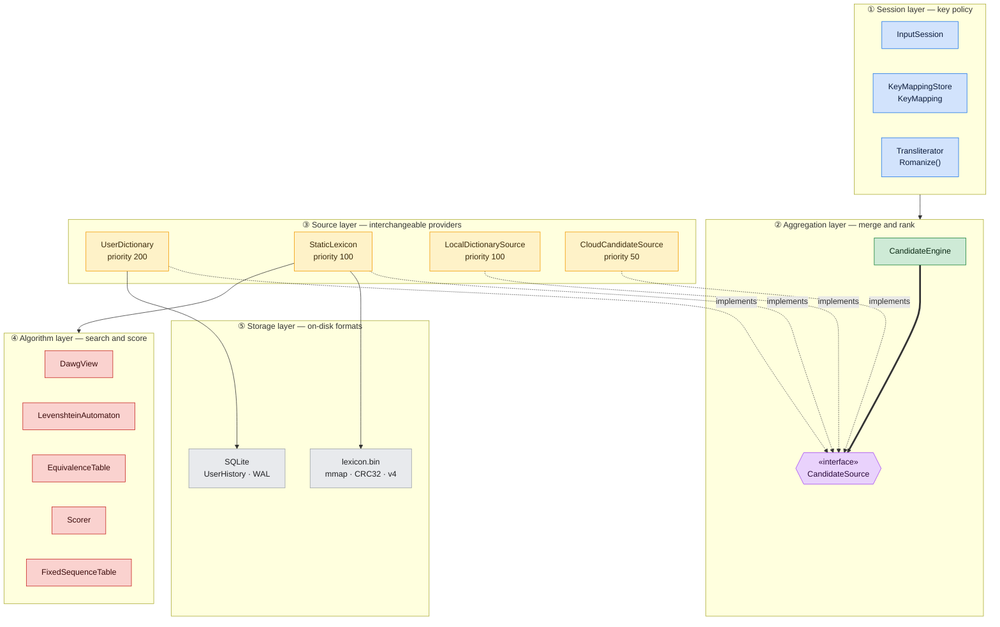
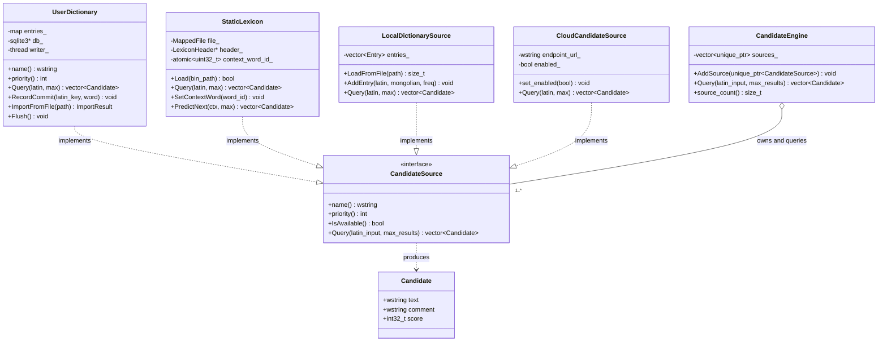
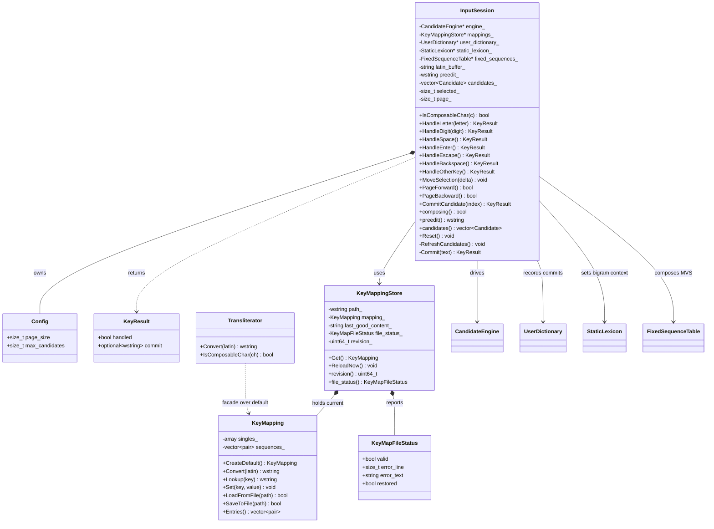
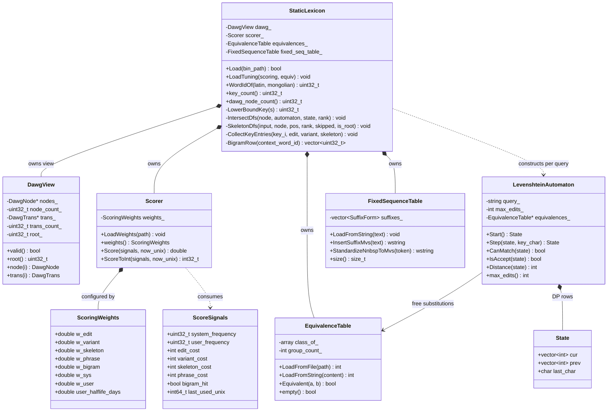
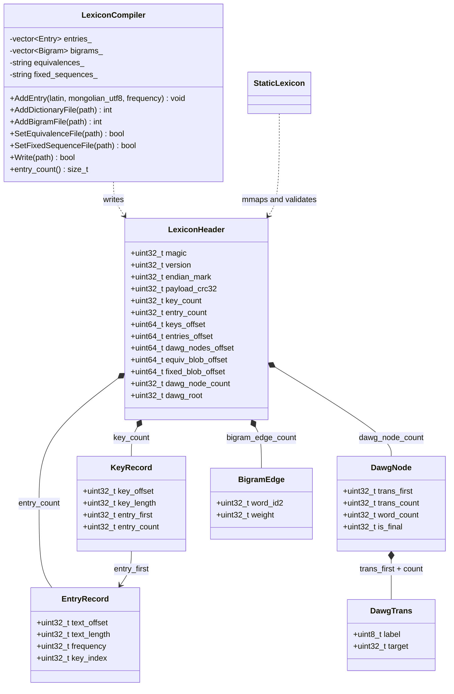
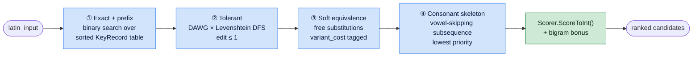

# Engine Architecture — Class Reference

Design documentation for **`paiza_core`**, the platform-neutral input-method
engine. Everything described here is pure C++20 with no OS dependencies: the
same objects back the Windows (TSF), macOS (InputMethodKit) and Linux (IBus)
front-ends.

**Scope**: the engine only. Platform adapters, UI widgets and settings stores
live under `src/platform/` and are documented in
[platform-parity.md](platform-parity.md), [macos-port.md](macos-port.md) and
[linux-port.md](linux-port.md). Algorithm rationale and the phased build-out
are in [core-engine-spec.md](core-engine-spec.md); the command-line tools are
in [engine-tools.md](engine-tools.md).

---

## 1. Layer map

The engine is five layers. A keystroke enters at the top; a ranked candidate
list comes back out.



| Layer | Responsibility | Key types |
|---|---|---|
| ① Session | Key policy state machine, keymap, transliteration | `InputSession`, `KeyMapping`, `KeyMappingStore` |
| ② Aggregation | Poll sources by priority, de-duplicate, cap | `CandidateEngine`, `CandidateSource` |
| ③ Sources | Interchangeable candidate providers | `UserDictionary`, `StaticLexicon`, … |
| ④ Algorithms | Tolerant search, equivalence, ranking, orthography | `DawgView`, `LevenshteinAutomaton`, `Scorer` |
| ⑤ Storage | Compiled binary lexicon, user persistence | `LexiconHeader` family, SQLite |

---

## 2. Class diagrams

Four focused diagrams rather than one dense graph — each covers one layer's
internal structure.

### 2.1 Candidate retrieval (the extensibility core)

The open/closed seam of the whole engine: `CandidateEngine` depends only on the
abstract `CandidateSource`, so a new provider (AI, speech, handwriting) is one
more `AddSource()` call with no change to the pipeline.



### 2.2 Session layer (the cross-platform parity contract)

`InputSession` holds **non-owning pointers** to everything — all four
collaborators must outlive the session. Its unit tests are the behavioural
contract that keeps the three front-ends identical.
(`KeyMapping::CreateDefault`, `Transliterator::Convert` and
`Transliterator::IsComposableChar` are `static`.)



### 2.3 Search and ranking algorithms

The Phase 3 "DFA × FST intersection": `StaticLexicon::IntersectDfs` walks
`DawgView` and `LevenshteinAutomaton` in lock-step, and every surviving
candidate is scored by the shared `Scorer`.



### 2.4 Offline compiler and binary layout

`LexiconCompiler` runs at build time only; the structs below are the on-disk
contract shared by writer and mmap reader, pinned by `static_assert` on every
`sizeof`.



---

## 3. Class reference by module

### 3.1 Session layer

| Class | Header | Responsibility |
|---|---|---|
| `InputSession` | `core/input_session.h` | The complete IME key policy as a testable state machine: letters compose, digits commit, Space/Enter/Escape semantics, candidate paging. **The cross-platform parity contract.** |
| `InputSession::Config` | same | Tuning: `page_size` (digit-selectable range, 1–9), `max_candidates` per keystroke. |
| `InputSession::KeyResult` | same | Return value: `handled` (was the key consumed) + optional `commit` text. |
| `KeyMapping` | `core/key_mapping.h` | Latin key sequence → Mongolian text. Case-sensitive; upper-case = second letter set; longest-sequence-wins (the `ng` digraph). |
| `KeyMappingStore` | `core/key_mapping_store.h` | Hot-reloading provider for `KeyMapping`. Polls the file (500 ms throttle), validates, and **restores the last good content** when an edit is malformed. |
| `KeyMapFileStatus` | same | Validation outcome for the settings UI: `valid`, `error_line`, `error_text`, `restored`. |
| `Transliterator` | `core/transliterator.h` | Static facade over the *default* mapping — the "simple algorithm" fallback when neither the service nor a user keymap is reachable. |
| `Romanize` *(free fn)* | `core/romanization.h` | Mongolian codepoints → canonical Latin key. Defined as the inverse of the default keymap, so dictionary keys are independent of the user's keymap. |

**`InputSession` — main methods**

| Method | Purpose | Notes |
|---|---|---|
| `IsComposableChar(char c)` | Does this key participate in composition? | ASCII letters + any non-digit printable with a keymap entry. Digits never compose. |
| `HandleLetter(char letter)` | Append to the buffer, re-query candidates | Starts a composition when none is active. |
| `HandleDigit(int digit)` | Commit candidate *n* of the current page | `handled=false` when the digit exceeds the page's count (key passes through). |
| `HandleSpace()` / `HandleEnter()` | Commit highlighted candidate / commit raw conversion | Enter commits the transliteration, not a candidate. |
| `HandleEscape()` / `HandleBackspace()` | Cancel / delete last letter | Backspace on an empty buffer cancels. |
| `HandleOtherKey()` | Any other key while composing | Commits the raw conversion and returns `handled=false` so the host still gets the key. |
| `MoveSelection(int delta)` / `PageForward()` / `PageBackward()` | Candidate navigation | Selection wraps; the page follows the selection. |
| `CommitCandidate(size_t index)` | Mouse click on the panel | |
| `preedit()` / `candidates()` / `composing()` | State for the host to render | Host mirrors `preedit()` into marked text. |
| `set_user_dictionary()` / `set_static_lexicon()` / `set_fixed_sequences()` | Wire optional collaborators | **All are non-owning; they must outlive the session.** |

**Host contract** — apply a `KeyResult` in this order:

1. If `commit` is set → insert that text into the client document.
2. If `composing()` → show `preedit()` as marked text and `candidates()` in the panel; otherwise clear marked text and hide the panel.
3. If `handled == false` → let the key fall through to the application.

### 3.2 Aggregation layer

| Class | Header | Responsibility |
|---|---|---|
| `Candidate` | `core/candidate.h` | Value type: `text` (Mongolian, UTF-16), `comment` (source tag), `score`. |
| `CandidateSource` | `core/candidate_source.h` | **Pure-virtual interface** every provider implements. The engine's extension point. |
| `CandidateEngine` | `core/candidate_engine.h` | Owns sources, queries them in priority order, de-duplicates by text (first wins), caps at `max_results`. |

**`CandidateSource` — the four methods to implement**

| Method | Contract |
|---|---|
| `name() → wstring` | Human-readable id, used for logging and the candidate comment tag. |
| `priority() → int` | Larger contributes earlier. Convention: user 200 > lexicon/local 100 > cloud 50. |
| `IsAvailable() → bool` | Unavailable sources are skipped entirely (e.g. cloud while offline). |
| `Query(latin_input, max_results) → vector<Candidate>` | **Must be safe to call from IPC worker threads.** |

> **Adding a provider**: subclass `CandidateSource`, implement the four methods,
> and call `engine.AddSource(std::make_unique<MySource>(...))` during startup.
> No other file changes. `AddSource` is **not** thread-safe against concurrent
> `Query` — register everything before serving keystrokes.

### 3.3 Source layer

| Class | Priority | Backing store | Responsibility |
|---|---|---|---|
| `UserDictionary` | 200 | SQLite (`UserHistory`, WAL) | Dynamic learning layer: frequency boosting, user-coined words, TXT import. In-memory ordered map so prefix search works; **zero I/O on the typing path**. |
| `StaticLexicon` | 100 | `lexicon.bin` (mmap) | Compiled read-only lexicon: exact/prefix/tolerant/skeleton search, bigram prediction. |
| `LocalDictionarySource` | 100 | `dictionary.txt` | Plain-text fallback used when `lexicon.bin` is missing or fails validation. |
| `CloudCandidateSource` | 50 | HTTP endpoint | Stub / extension point; disabled by default. |

**`UserDictionary` — main methods**

| Method | Purpose | Notes |
|---|---|---|
| `UserDictionary(wstring db_path)` | Construct; schema auto-created | Empty path = memory-only (tests). |
| `RecordCommit(latin_key, word)` | Bump frequency, or insert a user-coined entry | Called on every commit; updates memory immediately, schedules async persistence. |
| `ImportFromFile(path) → ImportResult` | Import `latin<TAB>mongolian[<TAB>freq]` | Existing entries keep `max(current, imported)`. Entries may be single letters **or whole phrases**. Returns `{opened, imported, skipped}`. |
| `Flush()` | Block until all pending writes reached SQLite | Tests and shutdown. |

**Threading**: `Query` / `RecordCommit` / `ImportFromFile` are thread-safe (on
Windows the IPC workers query while the settings window imports). A dedicated
writer thread owns the `sqlite3*` handle and batches writes ≥3 s apart; the
destructor flushes synchronously.

**`StaticLexicon` — main methods**

| Method | Purpose | Notes |
|---|---|---|
| `Load(bin_path) → bool` | mmap and validate the compiled lexicon | Checks magic / version / endianness / CRC32. **Returns false and stays unloaded on any failure** — never half-loads, so the engine can fall back to text. |
| `LoadTuning(scoring_path, equivalences_path)` | Optional runtime overrides | Missing files leave the embedded/default values untouched. |
| `Query(latin, max)` | The full search cascade | See §4.1. |
| `SetContextWord(word_id)` / `context_word()` | Bigram context from the last commit | `std::atomic` — on Windows the commit notice and the next query arrive on **different IPC worker threads**. `0` clears. |
| `WordIdOf(latin, mongolian) → uint32_t` | Resolve a committed pair to its id | `0` = unknown. |
| `PredictNext(ctx, max)` | Zero-input suggestion | Highest-weighted successors of the context word. |
| `scorer()` / `equivalences()` | Mutable accessors | How the settings page applies per-pair soft-equivalence toggles at runtime. |
| `fixed_sequence_table()` | Parsed GB/T D.2 suffix table | Handed to `InputSession::set_fixed_sequences`. |

### 3.4 Algorithm layer

| Class | Header | Responsibility |
|---|---|---|
| `BuildDawg` *(free fn)* | `core/dawg.h` | Offline Daciuk incremental minimisation over sorted unique keys → dense node/transition arrays. |
| `DawgView` | `core/dawg.h` | Zero-copy reader over the mmap'd DAWG arrays. |
| `LevenshteinAutomaton` | `core/levenshtein_automaton.h` | Bounded Damerau-Levenshtein (OSA recurrence) over a fixed query; the **DFA half** of the intersection. |
| `LevenshteinAutomaton::State` | same | Two DP rows (`cur`, `prev`) + `last_char`, so the transposition term `d[i-2][j-2]` is available. |
| `EquivalenceTable` | `core/equivalence_table.h` | Data-driven soft-equivalence classes (o/u, q/v, h/g, t/d, E/w) as a 256-entry class map. |
| `Scorer` | `core/scorer.h` | Log-domain linear ranking model; stateless, shared across sources. |
| `FixedSequenceTable` | `core/fixed_sequences.h` | GB/T table D.2 suffix forms: compose-time MVS insertion + vowel harmony. |

**Why the DAWG is "numbered"**: every state stores `word_count`, the number of
keys accepted in its sub-language. Accumulating those counts along a walk yields
the **lexicographic rank** of an accepted key — which *is* its `KeyRecord`
index. That makes the DAWG a minimal perfect hash and removes any need for a
key→id table.

**`LevenshteinAutomaton` — usage pattern**

```cpp
LevenshteinAutomaton automaton(query, /*max_edits=*/1, &equivalences_);
auto state = automaton.Start();
// For each candidate-key character during the DAWG walk:
state = automaton.Step(state, key_char);
if (!automaton.CanMatch(state)) return;      // Prune the whole subtree.
if (automaton.IsAccept(state)) { /* rank == KeyRecord index */ }
```

**`Scorer` — the model**

```
score = w_edit     * (-edit_cost)          // typo distance
      + w_variant  * (-variant_cost)       // soft-equivalence substitutions
      + w_skeleton * (-skeleton_cost)      // vowels omitted
      + w_phrase   * (-phrase_cost)        // extra words in a phrase
      + w_bigram   * (bigram_hit ? 1 : 0)
      + w_sys      * ln(system_frequency + 1)
      + w_user     * ln(decayed_user_frequency + 1)
```

| Weight | Default | Meaning |
|---|---|---|
| `w_edit` | 6.0 | Penalty per edit-distance unit |
| `w_variant` | 2.0 | Per soft-equivalence substitution. **Invariant: `0 < w_variant < w_edit`** — an exact spelling beats its variant, a variant beats a typo |
| `w_skeleton` | 3.0 | Per omitted vowel, so full spellings outrank abbreviations |
| `w_phrase` | 4.0 | Per extra word, so a phrase sits below the single word typed |
| `w_bigram` | 2.0 | Bonus when the previous word predicts this one |
| `w_sys` / `w_user` | 1.0 / 1.2 | Weights on log frequencies |
| `user_halflife_days` | 30.0 | Recency decay; `≤ 0` disables |

All are overridable from `scoring.txt` (`key=value`); missing keys keep their
default.

**`FixedSequenceTable` — two directions**

| Method | Direction | Use |
|---|---|---|
| `InsertSuffixMvs(text)` | compose-time | Longest-match a word-final suffix in the **raw conversion**, insert leading MVS (U+180E), harmonise a/e and u/ü to the stem's gender. |
| `StandardizeNnbspToMvs(token)` | corpus-time | `stem<NNBSP>suffix` → `stem<MVS>suffix` when the suffix is a standard D.2 form. A non-standard NNBSP (genuine enclitic) is left alone. |

> **Honest boundary**: suffix detection is heuristic with no morphological
> analysis — a stem that happens to end in a suffix shape can be mis-detected.
> It therefore only matches forms of length ≥ 2 and only rewrites the raw
> conversion; dictionary candidates are already correctly encoded and are never
> touched.

### 3.5 Storage layer

| Type | Size | Role |
|---|---|---|
| `LexiconHeader` | 160 B | magic `PZLX`, version (**4**), endian mark, payload CRC32, section offsets/counts |
| `KeyRecord` | 16 B | One Latin key: blob offset/length + its entry range |
| `EntryRecord` | 16 B | One word: string-pool offset/length, frequency, owning key |
| `DawgNode` / `DawgTrans` | 16 B / 8 B | Minimal numbered DAWG state / labelled edge |
| `BigramEdge` | 8 B | CSR edge `(word_id2, weight)` |
| `Crc32()` | — | IEEE 802.3 (zlib polynomial), table-driven |

**File layout** (all offsets from file start, little-endian):

```
LexiconHeader
KeyRecord[key_count]           sorted by key bytes
key blob                       concatenated Latin keys, no terminators
EntryRecord[entry_count]       grouped per key, frequency-descending
string pool                    concatenated UTF-8 Mongolian words
uint32[bigram_row_count+1]     CSR row offsets
BigramEdge[bigram_edge_count]  per row, weight-descending
DAWG nodes / transitions       (v2+)
equivalences blob              (v3+) raw equivalences.txt
fixed-sequences blob           (v4+) raw fixed_sequences.txt
```

`word_id` = `EntryRecord` index + 1 (`0` means "no word").

**Design invariants worth knowing**
- Every `sizeof` is pinned by `static_assert` — the layout *is* the contract.
- CRC32 covers everything after the header, so truncation or corruption is
  rejected **wholesale**.
- The equivalence and fixed-sequence rules are embedded **verbatim into the
  binary**, guaranteeing compile-time and query-time agree. This eliminates a
  whole class of config-skew bugs.

### 3.6 FFI boundary

`core/engine_c_api.h` — `extern "C"` for external hosts (C# Avalonia, Qt, …).
The in-repo front-ends bypass this and call C++ directly.

| Function | Purpose |
|---|---|
| `Engine_Initialize(db_path, lexicon_path, csr_path) → bool` | Create the engine; schema auto-created |
| `Engine_Search(latin_input, context_word_id) → const char*` | JSON: `{"candidates":[{"text":…,"source":"user\|lexicon","freq":N}]}` |
| `Engine_CommitCandidate(latin_input, mongolian_utf8)` | Update the user lexicon |
| `Engine_ImportUserDictionary(txt_path_utf8) → int` | Imported count, `-1` if unopenable |
| `Engine_Destroy()` | Flush and release |

**Contract**: not thread-safe — call from a single thread (an IME naturally
does). The string returned by `Engine_Search` is engine-owned and **invalid
after the next `Engine_*` call**; copy it to retain it. All strings are UTF-8.

---

## 4. Runtime behaviour

### 4.1 The search cascade

`StaticLexicon::Query` runs passes in order, stopping early once enough
candidates are collected. Each pass tags its cost, so ranking — not ordering —
decides the final list.



| Pass | Mechanism | Cost tagged |
|---|---|---|
| ① Exact / prefix | `LowerBoundKey` binary search | none |
| ② Tolerant | `IntersectDfs` — DAWG × automaton, Damerau ≤ 1 | `edit_cost = 1` |
| ③ Soft equivalence | Free substitutions inside the automaton, matched at distance 0 | `variant_cost` |
| ④ Consonant skeleton | `SkeletonDfs` — input must be a subsequence, omitted chars must all be vowels, **first character never skippable** | `skeleton_cost` |

Because exact matches carry zero cost and every other pass carries a positive
penalty, **an exact spelling always outranks a variant, which always outranks a
typo** — the property that made soft equivalence viable as a scoring tier rather
than a destructive key normalisation.

### 4.2 Dual-key lookup

A user may edit the keymap, but dictionary keys are fixed. Both sides are
therefore indexed and queried twice:

| Time | Key produced |
|---|---|
| Compile | the hand-written gloss key **and** `Romanize(mongolian)` |
| Query | the raw typed Latin **and** `Romanize(keymap.Convert(keys))` |

The results are merged and de-duplicated. This keeps "type the gloss" working
(`mongol` → ᠮᠣᠩᠭᠣᠯ) while a remapped keyboard still lands on the same entry
(`mqnggql` → ᠮᠣᠩᠭᠣᠯ). `Romanize` also strips format characters (BIRGA, NIRUGU,
FVS1-4, MVS, NNBSP) on **both** sides, so a word containing MVS is found without
typing MVS.

### 4.3 Assembling the engine

The order the three front-ends and `paiza_query` all use:

```cpp
// 1. Sources, in priority order.
auto user = std::make_unique<paiza::UserDictionary>(db_path);
auto* user_ptr = user.get();                       // Non-owning, for the session.

auto lexicon = std::make_unique<paiza::StaticLexicon>();
auto* lexicon_ptr = lexicon.get();
if (!lexicon->Load(bin_path)) { /* fall back to LocalDictionarySource */ }
lexicon->LoadTuning(scoring_path, equivalences_path);   // Optional.

// 2. Register with the engine (startup only — not thread-safe vs Query).
paiza::CandidateEngine engine;
engine.AddSource(std::move(user));
engine.AddSource(std::move(lexicon));

// 3. Session, wired to the optional collaborators.
paiza::KeyMappingStore mappings;
paiza::InputSession session(&engine, &mappings);
session.set_user_dictionary(user_ptr);
session.set_static_lexicon(lexicon_ptr);                       // Bigram context.
session.set_fixed_sequences(&lexicon_ptr->fixed_sequence_table());  // MVS compose.

// 4. Drive it from platform key events.
auto result = session.HandleLetter('s');
if (result.commit) InsertIntoDocument(*result.commit);
if (session.composing()) ShowPanel(session.preedit(), session.candidates());
```

**Lifetime rule**: `CandidateEngine` **owns** its sources via
`unique_ptr`; `InputSession` holds **non-owning** pointers to the engine,
keymap store, user dictionary, static lexicon and fixed-sequence table. Every
one of them must outlive the session. Keep the raw pointers *before* moving the
`unique_ptr`s into the engine, as above.

### 4.4 Threading model

| Component | Rule |
|---|---|
| `InputSession` | Single-threaded (the host's input thread). Not thread-safe. |
| `CandidateEngine::Query` | Thread-safe once configuration is done. `AddSource` is startup-only. |
| `CandidateSource::Query` | **Must** be safe to call from IPC worker threads. |
| `UserDictionary` | Fully thread-safe; a dedicated writer thread owns the SQLite handle. |
| `StaticLexicon` | Read-only after `Load`; `context_word_id_` is `std::atomic` because the commit notice and the next query arrive on different threads on Windows. |
| `Scorer` | Stateless after configuration; freely shared. |
| C FFI | Not thread-safe; single-threaded host calls only. |

### 4.5 Data files

| File | Consumed by | Purpose |
|---|---|---|
| `lexicon.bin` | `StaticLexicon` (mmap) | Compiled lexicon: DAWG, entries, bigrams, embedded rules |
| `dictionary.txt` | `LexiconCompiler`, `LocalDictionarySource` | Source lexicon, `latin<TAB>mongolian<TAB>freq` |
| `equivalences.txt` | `LexiconCompiler` → embedded; `EquivalenceTable` | Soft-equivalence groups |
| `fixed_sequences.txt` | `LexiconCompiler` → embedded; `FixedSequenceTable` | GB/T D.2/D.3 fixed sequences |
| `scoring.txt` | `Scorer::LoadWeights` | Weight overrides (`key=value`) |
| `keymap.txt` | `KeyMappingStore` | User keymap; **delta-saved** (only non-default entries) so old files inherit new defaults |
| `user.db` | `UserDictionary` | SQLite `UserHistory`, WAL mode |

---

## 5. Extension points

| I want to… | Do this |
|---|---|
| Add a candidate provider (AI, speech, handwriting) | Subclass `CandidateSource`, implement four methods, `engine.AddSource(...)`. Nothing else changes. |
| Change ranking behaviour | Edit `scoring.txt`, or set `ScoringWeights` via `StaticLexicon::scorer()`. Respect `0 < w_variant < w_edit`. |
| Add/remove a soft-equivalence pair | Edit `data/equivalences.txt` and recompile, or call `equivalences().LoadFromString(...)` at runtime (how the settings checkboxes work). |
| Support a new orthographic fixed sequence | Add a line to `data/fixed_sequences.txt`; the compiler embeds it, no code change. |
| Port to a fourth platform | Implement an adapter that drives `InputSession` and mirrors `preedit()`/`candidates()`. Run `tests/input_session_test.cc` as the parity contract. |
| Embed the engine in a non-C++ host | Use `core/engine_c_api.h`. Mind the string-lifetime and single-thread rules. |

---

## 6. Test coverage map

| Test file | Covers |
|---|---|
| `input_session_test.cc` | **The parity contract** — key policy, paging, commit semantics |
| `static_lexicon_test.cc` | Load/validate, all four search passes, bigram context |
| `dawg_test.cc` | Minimisation, numbering, rank ↔ key index |
| `levenshtein_automaton_test.cc` | OSA recurrence, transposition, pruning, accept |
| `scorer_test.cc` | Weight application, decay, tier ordering |
| `equivalence_table_test.cc` | Group parsing, symmetry, identity fallback |
| `fixed_sequences_test.cc` | MVS insertion, harmony, NNBSP standardisation |
| `romanization_test.cc` | Inverse-of-default property, format stripping, vowel keys |
| `user_dictionary_test.cc` | Learning, persistence, import, flush |
| `key_mapping_test.cc` | Validation, accept/reject/restore, delta-save |
| `candidate_engine_test.cc` | Priority ordering, de-duplication, capping |
| `engine_c_api_test.cc` | FFI lifecycle and JSON shape |
